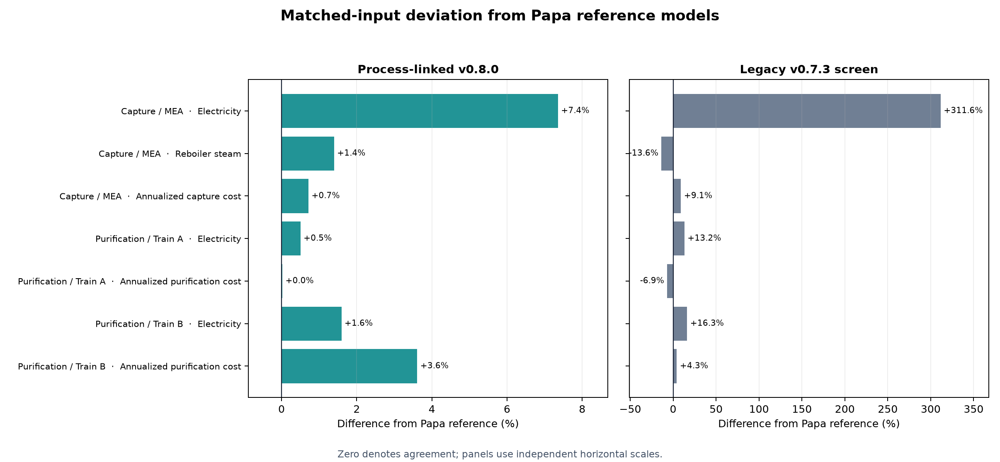

# Technical comparison: v0.7.3 screen, Papa references and process-linked interface

## Purpose and model boundary

This report documents the matched-input numerical cross-check used for the process-linked model. Capture ends at the wet, low-pressure CO₂ product. Purification receives that exact flow and composition, removes water and impurities, accounts for CO₂ loss, and performs compression to 110 bar. Pipeline hydraulics begin at 110 bar; compression is therefore not counted again in transport.

Papa's unmodified packages were executed locally from the preserved extraction directory. Their files were not copied into or changed by the application. The comparison runner reads the compact reference JSON created by `scripts/run_papa_reference.py`.

## Harmonized basis

- Wet flue gas: 14 mol-% CO₂, 11 mol-% H₂O, 4 mol-% O₂ and the same trace composition as Papa NB01.
- Capture throughput: 747,469.2 t CO₂/y; operating time: 8,000 h/y.
- Capture target: 92.455%.
- Product delivery pressure: 110 bar.
- Economics: 8% discount rate, 25 years; electricity €165/MWh. Capture steam is €7/GJ; purification thermal energy is €72/MWhth, matching the respective reference configurations.
- Papa and the improved model were run independently. The improved model adopts Papa's physical stage boundaries and reference assumptions; agreement therefore measures implementation consistency, not independent validation.

## Capture comparison

| Metric | Unit | Papa | Improved | Difference | Legacy |
|---|---:|---:|---:|---:|---:|
| CO2 capture efficiency | % | 92.45 | 92.45 | +0.0% | 92.45 |
| Wet raw-product CO2 | mol-% | 95.42 | 95.41 | -0.0% | — |
| Electricity | kWh/t captured CO2 | 7.289 | 7.825 | +7.4% | 30 |
| Reboiler steam | GJ/t captured CO2 | 4.05 | 4.107 | +1.4% | 3.5 |
| MEA makeup | kg/t captured CO2 | 2.829 | 2.77 | -2.1% | — |
| CAPEX | MEUR | 206.9 | 207.7 | +0.4% | 206.9 |
| Annualized capture cost | EUR/t captured CO2 | 73.75 | 74.28 | +0.7% | 80.45 |



The process-linked MEA calculation uses a molar cyclic-capacity balance for solvent circulation. Reboiler heat is the sum of CO₂ reaction heat, residual solvent sensible heat after the rich/lean exchanger, water vaporisation and a heat-loss allowance. Electricity is calculated from flue-gas blower work and rich-solvent pumping. MEA makeup responds to O₂ and SOₓ. The wet product composition is calculated from condensation and component-specific transfer factors and becomes the purification inlet.

## Purification comparison — Train A analogue

| Metric | Unit | Papa | Improved | Difference | Legacy |
|---|---:|---:|---:|---:|---:|
| CO2 recovery | % | 99.92 | 99.92 | +0.0% | 99.92 |
| Product CO2 | mol-% | 99.88 | 99.89 | +0.0% | 99.88 |
| Electricity | kWh/t feed CO2 | 105.9 | 106.5 | +0.5% | 119.9 |
| Thermal duty | kWhth/t feed CO2 | 42.84 | 40.6 | -5.2% | 0 |
| Cooling duty | kWhth/t feed CO2 | 149 | 149 | +0.0% | 0 |
| CAPEX | MEUR | 60.54 | 64.3 | +6.2% | 60.68 |
| Annualized purification cost | EUR/t product CO2 | 37.22 | 37.23 | +0.0% | 34.66 |

The interface analogue represents knockout/cooling, impurity polishing, deoxygenation, dehydration and multistage compression. It is intentionally faster and less unit-resolved than Papa Train A, but uses the same connected wet feed and reports electrical, thermal and cooling duties separately.

## Purification comparison — Train B analogue

| Metric | Unit | Papa | Improved | Difference | Legacy |
|---|---:|---:|---:|---:|---:|
| CO2 recovery | % | 99.69 | 99.69 | +0.0% | 99.69 |
| Product CO2 | mol-% | 99.98 | 99.98 | +0.0% | 99.98 |
| Electricity | kWh/t feed CO2 | 145.7 | 148 | +1.6% | 169.5 |
| Thermal duty | kWhth/t feed CO2 | 2.477 | 2.444 | -1.3% | 0 |
| Cooling duty | kWhth/t feed CO2 | 106.1 | 106.7 | +0.6% | 0 |
| CAPEX | MEUR | 111.7 | 121.3 | +8.6% | 112.2 |
| Annualized purification cost | EUR/t product CO2 | 49.06 | 50.83 | +3.6% | 51.17 |

The cryogenic analogue adds deep dehydration, non-condensable removal and refrigeration. Papa's detailed column, guard-bed, solid-risk and phase-equilibrium diagnostics remain more detailed; the interface exposes this train as a configurable engineering family for cluster scenarios.

## Implemented scientific changes

1. The capture wet-product flow, temperature, pressure and component composition are transmitted directly into purification.
2. Purification performs a component balance and returns the achieved composition; it never creates inert gas merely to satisfy an inconsistent purity/trace target.
3. Multistage compression work is calculated from pressure ratio, mixture molecular weight, stage count and isentropic efficiency, and is counted only in purification.
4. MEA heat and degradation equations are restricted to the MEA technology family. Cryogenic, oxyfuel, DMX and membrane routes retain separate technology-family equations.
5. Utilities, consumables, annualized equipment, fixed O&M and variable O&M have explicit cost and environmental boundaries.
6. The v0.7.3 coefficient screen remains selectable and reproduces its cost results for regression comparison.

## Interpretation and limitations

- Papa's capture model is stagewise and closes lean-loading recycle; the improved interface uses an analytical multi-source surrogate with the same energy terms.
- Papa's purification trains resolve individual unit operations and species; the interface aggregates them into configurable train families while preserving the wet-feed handoff, component balance and utility boundaries.
- Exact agreement is not expected where unit sizing, trace chemistry, refrigerant treatment or consumable inventories differ.
- The matched comparison is a numerical cross-check, not independent experimental validation.

Source-specific flue-gas defaults in `config/process_sources.toml` are labelled engineering proxies. They are editable in the interface and must be replaced by plant assays for FEED. Product acceptance remains governed by the receiving-system specification. The present cross-check supports code verification and model consistency; it does not replace vendor design, pilot testing or independent experimental validation.

## Reproduction

```powershell
python scripts/run_papa_reference.py
python scripts/compare_papa_models.py
python -m unittest discover -s tests -v
```

Generated numerical files and the comparison figure are in `verification/comparison/`.
