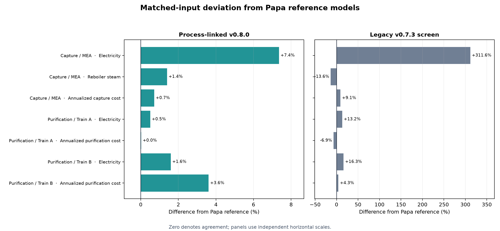

# Verification report — process-linked v0.8.0

## Verification status

- 46 automated model, UI, EOS, trajectory and integration tests pass.
- All four standard scenarios were regenerated with the process-linked calculation.
- The frozen v0.7.3 coefficient calculation remains selectable and its announced-case cost regression is exact.
- Papa's preserved capture and purification packages were executed without modification and compared on a harmonized basis.
- These checks demonstrate software consistency and matched-model agreement; they are not independent experimental or vendor validation.

## Connected-stage invariants

| Scenario | Capture output = purification input | Purification product = transport input | Maximum mass-balance residual |
|---|---:|---:|---:|
| announced_2030 | Pass | Pass | 7.99e-17 |
| reported_2024_cluster | Pass | Pass | 5.70e-17 |
| user_inventory_4mt | Pass | Pass | 1.24e-16 |
| user_inventory_unconstrained | Pass | Pass | 1.24e-16 |

## Announced 2030 case: frozen screen versus connected model

| Metric | Unit | v0.7.3 screen | v0.8.0 process-linked | Change |
|---|---:|---:|---:|---:|
| Captured CO2 | Mt/y | 1.417 | 1.417 | +0.00% |
| Purified CO2 | Mt/y | 1.410 | 1.410 | +0.00% |
| Lifecycle net avoided | Mt/y | 1.382 | 1.372 | -0.73% |
| Climate burden | ktCO2e/y | 27.6 | 37.7 | +36.44% |
| Climate intensity | kgCO2e/t | 19.61 | 26.75 | +36.44% |
| Capture CAPEX | MEUR | 400.000 | 400.000 | +0.00% |
| Purification CAPEX | MEUR | 98.444 | 181.722 | +84.59% |
| Total chain CAPEX | MEUR | 617.984 | 701.262 | +13.48% |
| Capture cost | EUR/t | 53.68 | 48.52 | -9.61% |
| Purification cost | EUR/t | 20.16 | 25.76 | +27.76% |
| Pipeline cost | EUR/t | 8.33 | 8.33 | +0.00% |
| Full-chain cost | EUR/t | 82.18 | 82.61 | +0.53% |

The CO2 flow and route are unchanged because the announced source flows, recovery and receiver limit are unchanged. Cost and climate results change because capture/purification utilities, equipment, cooling and consumables are now calculated from connected process conditions rather than stage multipliers.

## Matched-input Papa cross-check

| Stage / analogue | Metric | Unit | Papa | v0.8.0 | Difference |
|---|---|---:|---:|---:|---:|
| Capture / MEA | Electricity | kWh/t captured CO2 | 7.289 | 7.825 | +7.36% |
| Capture / MEA | Reboiler steam | GJ/t captured CO2 | 4.050 | 4.107 | +1.40% |
| Capture / MEA | Annualized capture cost | EUR/t captured CO2 | 73.750 | 74.278 | +0.72% |
| Purification / Train A | Electricity | kWh/t feed CO2 | 105.943 | 106.477 | +0.50% |
| Purification / Train A | Annualized purification cost | EUR/t product CO2 | 37.224 | 37.233 | +0.02% |
| Purification / Train B | Electricity | kWh/t feed CO2 | 145.678 | 148.000 | +1.59% |
| Purification / Train B | Annualized purification cost | EUR/t product CO2 | 49.062 | 50.833 | +3.61% |

## Remaining validation needs

- Replace source gas-composition proxies with reconciled plant assays and operating envelopes.
- Validate capture and purification performance with vendor simulations, guarantees or pilot data.
- Confirm the contractual receiving-network product specification and phase-envelope margin.
- Replace screening CAPEX factors with route- and site-specific quantities and quotations.
- Perform non-isothermal transient hydraulics and code-based mechanical design before FEED decisions.

The complete numerical differences for all scenarios are in `verification/comparison/release_delta.csv`.
